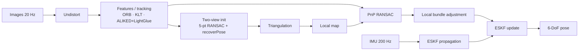

# drone-vio — Monocular Visual(-Inertial) Odometry for Indoor Drones

[](https://github.com/yanishalloum/drone-vio/actions)


> Estimating the 6-DoF trajectory of a drone in a GPS-denied indoor environment from a **single camera** (+ IMU), built **from first principles** and benchmarked against state-of-the-art classical and learning-based systems on the **EuRoC MAV** dataset.

<!-- TODO: add docs/assets/demo.gif (trajectory vs ground truth + feature tracks) once Phase 2 works:
<p align="center"></p> -->

---

## Why this project

This repository is a rewrite of a course project (Polytechnique Montréal, *Navigation Systems*). The original report had several geometric and estimation flaws — documented honestly in [`docs/postmortem.md`](docs/postmortem.md). Fixing them step by step, and measuring every change, is the point of this repo.

**Goals**
1. Understand every block of a modern VO/VIO pipeline by implementing it.
2. Quantify each improvement with standard metrics (ATE / RPE via [`evo`](https://github.com/MichaelGrupp/evo)).
3. Compare a classical pipeline with learned components (LightGlue, DPVO, …) **on the same benchmark**.

## Results

EuRoC MAV, ATE RMSE [m] (Sim(3)-aligned for monocular, SE(3) for VIO). *Filled in as phases are completed.*

| Method | MH_01_easy | MH_03_medium | V1_01_easy | Runtime |
|---|---|---|---|---|
| v0 – original report (frame-to-frame E + EKF) | — | — | — | — |
| v1 – two-view VO, 5-pt RANSAC | — | — | — | — |
| v2 – frame-to-map (PnP) | — | — | — | — |
| v3 – + local bundle adjustment | — | — | — | — |
| v4 – + ESKF (IMU fusion) | — | — | — | — |
| v5 – learned front-end (ALIKED + LightGlue) | — | — | — | — |
| Reference: DPVO | — | — | — | — |
| Reference: OpenVINS | — | — | — | — |

## Pipeline



## Roadmap

- [ ] **Phase 0** – EuRoC loader, undistortion, ground-truth in camera frame, `evo` evaluation
- [ ] **Phase 1** – Correct two-view geometry (essential matrix, cheirality, pose composition)
- [ ] **Phase 2** – Frame-to-map tracking (triangulation + PnP), keyframes, consistent scale
- [ ] **Phase 3** – Sliding-window bundle adjustment (SE(3) on-manifold optimisation)
- [ ] **Phase 4** – Error-State Kalman Filter with IMU (metric scale, gravity)
- [ ] **Phase 5** – Learned components: ALIKED/SuperPoint + LightGlue, comparison with DPVO / MASt3R-SLAM
- [ ] **Phase 6** – (optional) Loop closure → SLAM

Detailed plan, theory notes and reading list: [`docs/roadmap.md`](docs/roadmap.md).

## Quickstart

```bash
git clone https://github.com/yanishalloum/drone-vio.git && cd drone-vio
python -m venv .venv && source .venv/bin/activate
pip install -e ".[dev]"          # add ".[learned]" for Phase 5 (needs PyTorch)

# Download an EuRoC sequence (ASL format) into data/euroc/MH_01_easy/
# https://projects.asl.ethz.ch/datasets/doku.php?id=kmavvisualinertialdatasets

python scripts/run_vo.py --config configs/euroc_mono.yaml --seq data/euroc/MH_01_easy
bash scripts/evaluate.sh results/MH_01_easy
```

## Repository layout

```
src/dronevio/
  datasets/     EuRoC loading, calibration, ground-truth conversion
  frontend/     feature detection, description, matching, tracking
  geometry/     SE(3) utilities, two-view geometry, triangulation, PnP
  backend/      bundle adjustment
  fusion/       error-state Kalman filter (IMU)
  learned/      wrappers around learned matchers / VO systems
  evaluation/   trajectory I/O (TUM format), metrics helpers
configs/        YAML configs per dataset
scripts/        entry points (run, evaluate)
docs/           roadmap, theory notes per phase, postmortem of v0
tests/          unit tests (conventions, geometry on synthetic data)
```

## Conventions

`T_AB` maps points from frame **B** to frame **A** (`p_A = T_AB @ p_B`); `T_WC` is the camera pose in the world. Quaternions are Hamilton `[w, x, y, z]`. See [`docs/roadmap.md`](docs/roadmap.md#0-conventions).

## What I learned

*To be written as the project progresses — one or two lines per phase (e.g. "why monocular scale is unobservable and how the IMU fixes it").*

## References

- D. Scaramuzza, F. Fraundorfer — *Visual Odometry: Part I & II*, IEEE RAM 2011/2012
- R. Hartley, A. Zisserman — *Multiple View Geometry in Computer Vision*
- J. Solà — *Quaternion kinematics for the error-state Kalman filter*, arXiv:1711.02508
- C. Forster et al. — *On-Manifold Preintegration for Real-Time VIO*, T-RO 2017
- P. Lindenberger et al. — *LightGlue*, ICCV 2023
- Z. Teed, L. Lipson, J. Deng — *Deep Patch Visual Odometry*, NeurIPS 2023
- M. Burri et al. — *The EuRoC micro aerial vehicle datasets*, IJRR 2016

## License

MIT — see [LICENSE](LICENSE). Note: some optional learned models (e.g. SuperPoint weights) have their own, more restrictive licenses.
